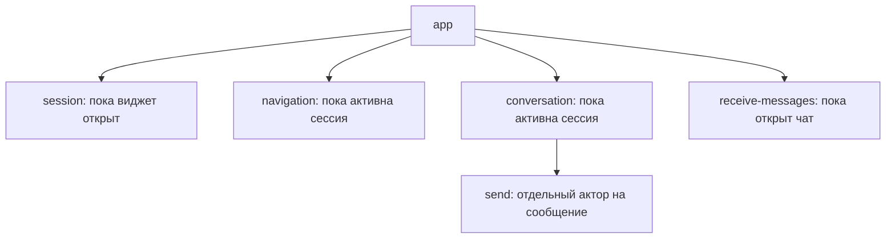
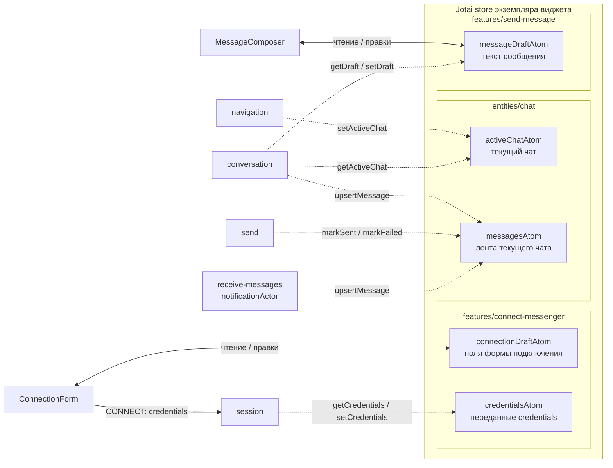
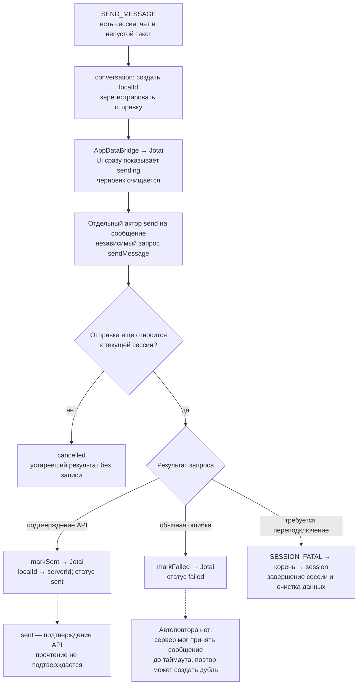

# GREEN-API Messenger

React-виджет текстовой переписки в WhatsApp через GREEN-API. На desktop — панель, на mobile — полноэкранный диалог.

**Сценарий:** подключиться по `idInstance` и `apiTokenInstance` → открыть чат по номеру → отправлять и получать текст.

## Основные решения

| Решение                                                                                                                   | Почему                                                                                                      |
| ------------------------------------------------------------------------------------------------------------------------- | ----------------------------------------------------------------------------------------------------------- |
| [XState для процессов, Jotai для данных](#состояние-и-данные)                                                             | Сроки жизни запросов задаются графом машин; формы и лента обновляются через атомы без дублирования данных   |
| [Оптимистичная отправка](#отправка-и-получение)                                                                           | Сообщение сразу видно в ленте; отдельный актор позволяет обрабатывать и отменять каждую отправку независимо |
| [Изоляция экземпляров](#атомы-jotai-и-связи-с-машинами) и [защита от устаревших ответов](#отмена-и-устаревшие-результаты) | Виджеты не делят сессию и данные; поздний ответ отменённой операции не меняет текущее состояние             |
| [FSD](#границы-модулей) и [DI транспорта](#транспорт-и-зависимости)                                                       | Features связаны через корневую машину, API скрыт за контрактом;                                            |
| [Мгновенная форма и ленивые экраны](#сборка-и-lcp)                                                                        | Форма подключения готова к открытию; форма номера и переписка загружаются только на своих этапах            |
| [Брендированные типы поверх DTO](#dto-и-брендированные-типы)                                                              | TypeScript различает ID сообщения, ID чата и время без изменения их представления в runtime                 |

**Объём:** один выбранный чат на виджет; без списков чатов, контактов, групп и загрузки истории. Данные живут в памяти сессии.

[Запуск](#запуск) · [Проверки](#проверки) · [Новая feature](#новая-feature) · [Сборка и LCP](#сборка-и-lcp)

## Запуск

Требуется **Bun ≥ 1.4.2**. Стек: React, TypeScript, XState, Jotai, MaxUI; версии зависимостей закреплены в `bun.lock`.

```powershell
bun install --frozen-lockfile
bun run dev
```

Адрес dev-сервера выводится в терминале.

В форме указать credentials авторизованного в WhatsApp инстанса, затем международный номер. Для HTTP-получения уведомлений нужны `webhookUrl: ""` и `incomingWebhook: "yes"`. Enter отправляет сообщение, Shift+Enter добавляет строку.

Для автозаполнения формы скопировать [`.env.dev.example`](.env.dev.example) в игнорируемый `.env.dev`. `BUN_PUBLIC_GREEN_API_API_URL` задаёт адрес API, по умолчанию — `https://api.green-api.com`. Значения доступны браузеру только в dev.

```powershell
bun run build
bun run serve
```

Production доступен на http://127.0.0.1:4175. `serve` отдаёт текущий `dist` без пересборки; если он уже готов, достаточно второй команды.

## Проверки

| Команда            | Что проверяет                                                                                         |
| ------------------ | ----------------------------------------------------------------------------------------------------- |
| `bun run check`    | TypeScript, oxlint, oxfmt, production build, unit-тесты Bun и компонентные тесты Playwright           |
| `bun run test:e2e` | Production-запуск, текст без JavaScript, CSS, desktop/mobile, фокус и реальные запросы ленивых чанков |

E2E запускаются отдельно от `check`. При отсутствии Chromium выполнить `bun run test:e2e:install`.

Тесты находятся в `__tests__` внутри каталога проверяемого модуля: например, `ui/ConnectionForm.tsx` и `ui/__tests__/ConnectionForm.ct.spec.ts`. Проверки типов и локальные тестовые helpers также отделены от рабочего кода.

Тесты покрывают переходы машин, отмену и поздние ответы, изоляцию store, очистку при unmount и поведение UI. Транспорт проверяется на управляемых ответах; компонентные тесты блокируют внешний HTTP. Реальный обмен с GREEN-API требует отдельной проверки с авторизованным инстансом и получателем в WhatsApp.

## Состояние и данные

**XState** описывает подключение, выбор чата, polling и отправки как процессы с разными сроками жизни. Вход в состояние запускает акторы, выход останавливает их; завершение HTTP-запросов и ошибки обрабатываются переходами.

[Корневая машина](src/app/model/state-machine/app-machine.ts) задаёт сроки жизни дочерних процессов:



| Машина (имя на схеме)                                                                                                        | Что делает                                                                                   | Зачем выделена                                                      |
| ---------------------------------------------------------------------------------------------------------------------------- | -------------------------------------------------------------------------------------------- | ------------------------------------------------------------------- |
| [appMachine](src/app/model/state-machine/app-machine.ts) (`app`)                                                             | Открывает и закрывает виджет, запускает дочерние машины и маршрутизирует их события          | Собирает общий жизненный цикл, не связывая features напрямую        |
| [connectMessengerMachine](src/features/connect-messenger/model/state-machine/connect-messenger-machine.ts) (`session`)       | Проверяет подключение, обрабатывает повторные попытки и завершает сессию                     | Задаёт общую границу доступности клиента для всех операций          |
| [startChatMachine](src/features/start-chat/model/state-machine/start-chat-machine.ts) (`navigation`)                         | Проверяет номер, получает чат через API и сообщает о его открытии                            | Изолирует асинхронный выбор чата, его отмену и ошибки               |
| [messageSendingMachine](src/features/send-message/model/state-machine/message-sending-machine.ts) (`conversation`)           | Принимает команды отправки, создаёт оптимистичные сообщения и управляет дочерними отправками | Сохраняет начатые отправки при возврате к форме номера              |
| [sendMachine](src/features/send-message/model/state-machine/send-machine.ts) (`send`)                                        | Выполняет одну отправку и завершает её как `sent`, `failed` или `cancelled`                  | Даёт каждому сообщению независимые запрос, результат и отмену       |
| [receiveMessagesMachine](src/features/receive-messages/model/state-machine/receive-messages-machine.ts) (`receive-messages`) | Запускает последовательное получение и подтверждение уведомлений, передаёт ошибки сессии     | Привязывает polling к открытому чату и останавливает его при выходе |

Имена состояний, событий и обработчиков собраны в словарях; тесты сверяют их с графами, чтобы переименование не оставляло неверных переходов.

**Jotai** хранит credentials, чат, сообщения и черновики. UI подписывается на атомы, машины работают с ними через [AppDataBridge](src/app/model/data-state/create-app-data-bridge.ts). Цена разделения — явный мост между процессами и данными.

[AppProvider](src/app/providers/AppProvider.tsx) связывает store и дерево акторов одного экземпляра. Узкие контексты дают UI актор своей feature без передачи через цепочку props.

### Атомы Jotai и связи с машинами

Пять атомов сгруппированы по модулям, но их значения хранятся в **одном store на экземпляр виджета**. Пунктирные связи — операции машин через `AppDataBridge`; сплошные — чтение и правки полей UI, а также отправка события `CONNECT`.



`connectionDraftAtom` отделён от `credentialsAtom`: правки формы становятся данными подключения при `CONNECT`. При смене `chatId` мост очищает ленту и черновик сообщения. При завершении сессии `AppRuntimeOwner` вызывает `clearSession` для credentials, чата, сообщений и текста; `AppProvider` отдельно заполняет и сбрасывает черновик подключения по состояниям `app` и `session`.

## Отправка и получение



Polling выполняет цикл **получить → обработать → подтвердить удалением → получить следующее**. Последовательность предотвращает конкурирующее чтение очереди. Неподдерживаемые уведомления и сообщения других чатов подтверждаются без добавления в ленту; повторы сообщений объединяются по `message.id`. `receiptId` используется для подтверждения очереди, а не для идентификации сообщения.

### Отмена и устаревшие результаты

Одного `AbortSignal` недостаточно: ответ может прийти одновременно с закрытием или сменой сессии. [AppRuntimeOwner](src/shared/lib/app-state/runtime/app-runtime.ts) проверяет актуальность попытки подключения, операции, polling и отправки перед записью результата. При завершении сессии он инвалидирует эти операции, отменяет отправки, освобождает клиент и очищает данные. Очистка при unmount выполняется явно и допускает повторный вызов.

Отправки принадлежат сессии: возврат к форме номера не отменяет уже начатую отправку. Это сохраняет действие пользователя при навигации; закрытие виджета или отключение сессии завершает его жизненный цикл.

## Транспорт и зависимости

Машины зависят от [MessengerService](src/shared/service/messenger/MessengerService.ts): проверки подключения, разрешения номера в чат, отправки, получения и подтверждения уведомлений. Контракт использует DTO без SDK-типов; детали API и преобразование ответов остаются в адаптерах. Это позволяет менять транспорт и подставлять управляемые ответы в тестах без изменений UI.

[createAppRuntime](src/app/model/runtime/create-app-runtime.ts) выбирает фабрику сессий и передаёт зависимости через input машин. Клиент создаётся на попытку подключения и после успеха используется до конца сессии: у всех операций один владелец ресурсов.

- `green-api-rest` обращается к API через `fetch`; [main.tsx](src/app/main.tsx) использует отдельный [createRestAppRuntime](src/app/model/runtime/create-rest-app-runtime.ts), чтобы код SDK не попадал в сборку демонстрационной страницы.
- `green-api-sdk` оборачивает официальный SDK; это вариант по умолчанию для `createAppRuntime()`.
- Оба используют общий HTTP-транспорт и мапперы: отмена, таймауты и преобразование ошибок не расходятся между реализациями. HTTP-граница SDK заменена, чтобы поддержать эти правила и исключить его логирование запросов с токенами.

## DTO и брендированные типы

[DTO](src/shared/service/messenger/dto.ts) содержат обычные `string` и `number`. Внутренние [ChatSummary и ChatMessage](src/entities/chat/model/types.ts) сохраняют структуру DTO, заменяя отдельные поля брендированными типами:

| Поле DTO            | Внутренний тип       |
| ------------------- | -------------------- |
| `id: string`        | `MessengerId`        |
| `chatId: string`    | `MessengerChatId`    |
| `timestamp: number` | `MessengerTimestamp` |

Собственный [Brand](src/shared/lib/messenger-values/brand.ts) на `unique symbol` не позволяет случайно подменить ID сообщения ID чата или числом времени. Проверка действует в TypeScript; в runtime значения остаются строками и числами.

Преобразование выполняют [createChatSummary и createChatMessage](src/entities/chat/model/chat-mappers.ts) через фабрики брендированных значений. **Полная проверка схемы DTO при конвертации сейчас не используется**: фабрики проверяют только отдельные инварианты — непустые ID и целочисленное неотрицательное время в миллисекундах. Проверку всей схемы можно добавить перед маппингом как дополнительную опцию; бренды сами по себе не гарантируют корректность внешних данных.

<details>
<summary>Альтернативы: библиотеки брендирования и валидации</summary>

| Библиотека / модуль                                                                      | Механизм брендирования                                    | Проверка в runtime                                |
| ---------------------------------------------------------------------------------------- | --------------------------------------------------------- | ------------------------------------------------- |
| [Zod](https://zod.dev/api#branded-types)                                                 | `.brand<Name>()` — бренд выходного типа схемы             | Проверка при `parse` / `safeParse`                |
| [Effect.Schema](https://effect.website/docs/v4/schema/advanced-usage#branded-types)      | `Schema.brand`, `Schema.fromBrand` — брендированные схемы | Проверка при декодировании по схеме               |
| [Valibot](https://valibot.dev/api/brand/)                                                | `v.brand(name)` в pipeline схемы                          | Проверка при `parse` / `safeParse`                |
| [io-ts](https://github.com/gcanti/io-ts/blob/master/index.md#branded-types--refinements) | `t.brand` — брендированный codec с предикатом             | Проверка при `decode`                             |
| [Effect.Brand](https://effect.website/docs/v4/code-style/branded-types)                  | `Brand.nominal` / `Brand.make` — конструкторы брендов     | `nominal` без проверки; `make` проверяет предикат |
| [ts-brand](https://github.com/kourge/ts-brand#api)                                       | `Brand`, `make` — типы и фабрики брендов                  | Можно передать собственный валидатор в `make`     |
| [type-fest](https://github.com/sindresorhus/type-fest/blob/main/source/tagged.d.ts)      | `Tagged` — типовые метки, включая несколько тегов         | Только типы; проверка реализуется отдельно        |

Библиотека схем полезна, когда требуется проверка всего DTO; для типовых меток достаточно собственного `Brand`.

</details>

## Границы модулей

Структура разделяет сборку приложения, пользовательские действия и транспорт, чтобы изменение GREEN-API или оболочки не требовало переписывать сценарий переписки.

| Слой                  | Ответственность                                       | Почему здесь                                              |
| --------------------- | ----------------------------------------------------- | --------------------------------------------------------- |
| `app`                 | Провайдеры, runtime, координация акторов              | Все связи между features собираются в одном месте         |
| `widgets/chat-widget` | Launcher, desktop/mobile-оболочки, композиция экранов | Адаптивность отделена от подключения и обмена сообщениями |
| `features/*`          | Подключение, открытие чата, отправка и получение      | Сценарии можно изменять и проверять отдельно              |
| `entities/chat`       | Данные чата, атомы и отображение сообщений            | Лента используется независимо от транспорта и сценариев   |
| `shared`              | Контракты, runtime-хелперы, адаптеры GREEN-API        | Нижние слои не зависят от конкретных features             |

Features не импортируют друг друга: связь проходит через корневую машину и события `AppProtocol`. Слайсы features/entities открывают модели через `index.ts`, компоненты — через `ui.ts`: импорт модели не подтягивает UI и его зависимости в начальный JS. Внутри слайса используются относительные импорты, между слайсами — `@/*`. Это ограничивает распространение изменений; цена — явная интеграция каждого сценария в `app`.

### Новая feature

1. Создать `src/features/<name>/`: машину, типы, словарь событий и селекторы; UI и атомы — по необходимости. Открыть модели через `index.ts`, компоненты — через отдельный `ui.ts`.
2. Зарегистрировать машину в `setup.actors` корневой `appMachine` и словаре `app-vocabulary.ts`. Добавить `invoke` в состояние, определяющее срок её жизни (`opened`, `workflow` или `chat`), передать зависимости через input. При необходимости дополнить `AppProtocol` и типы событий для координации с корнем.
3. Для feature с UI вывести ref дочернего актора из `snapshot.children` в `AppProvider`, передать через её контекст и добавить компонент в композицию виджета. UI первого действия подключить обычным импортом; экран позднего этапа — через `React.lazy(() => import(...))` и рендерить только в нужном состоянии. `Suspense` показывает ожидание загрузки. Фоновому процессу достаточно `invoke`.
4. Если машине нужны новые данные, добавить атомы в существующий store и методы в `AppDataBridge`; новые сервисные зависимости собрать в runtime приложения.
5. Добавить тесты сценария, включить машину и её словарь в проверки графов; проверить остановку при выходе из состояния и выполнить `bun run check`.

Логика и тесты остаются внутри feature; `app` явно задаёт её зависимости и срок жизни. Поэтому новую возможность можно добавить, сохранив контракты соседних сценариев.

## Сессия и devtools

Credentials не сохраняются в cookies/localStorage, чтобы токен не оставался на диске и не разделялся между экземплярами. `bun run build` отключает подстановку env через `env: "disable"`: локальные dev-credentials не встраиваются в production, форму заполняет пользователь. Ошибки преобразуются в безопасные сообщения; dev-only Stately Inspector скрывает credentials и тексты, а Jotai DevTools помогает видеть изменения данных.

## Сборка и LCP

Виджет подключается обычным React-деревом: [`main.tsx`](src/app/main.tsx) → `createRoot` → `App`. `bun run build` запускает [скрипт сборки](scripts/build.ts), который создаёт `dist/index.html` и внешние JS/CSS-файлы.

Заголовок и описание demo находятся в [HTML](index.html), вне React-контейнера: пользователь видит содержимое страницы, пока инициализируется виджет.

| Решение                                                                | Зачем                                                                                           |
| ---------------------------------------------------------------------- | ----------------------------------------------------------------------------------------------- |
| Минификация и `NODE_ENV=production`                                    | Уменьшают объём ресурсов; удаление недостижимого кода исключает dev-ветки и DevTools            |
| [`splitting: true`](https://bun.sh/docs/bundler#splitting), формат ESM | Позволяют выделять общие и динамически импортируемые модули в чанки                             |
| Обычный импорт формы подключения                                       | Позволяет показать форму сразу по клику, без ожидания дополнительных JS-запросов                |
| `React.lazy` и условный рендеринг поздних экранов                      | Загружают форму номера и переписку при первом использовании; общие зависимости переиспользуются |
| Хеши в именах JS/CSS                                                   | Позволяют долго кешировать конкретную версию ресурса и менять URL при изменении содержимого     |
| Критический CSS кнопки внутри HTML                                     | Небольшой стиль доступен сразу из документа; крупные стили остаются во внешнем кеше             |

Источник критического CSS — [`widget-launcher.css`](src/widgets/chat-widget/ui/launcher/widget-launcher.css). В production сборщик заменяет `<link data-critical>` на минифицированный `<style data-critical>`. Стиль принадлежит виджету и не содержит оформления host-страницы; при встраивании в другое React-приложение его можно включить в критические стили этого приложения.

Начальная панель собрана в [WidgetPanel](src/widgets/chat-widget/ui/content/WidgetPanel.tsx), её показом управляет [OpenedWidget](src/widgets/chat-widget/ui/content/OpenedWidget.tsx). Границы ленивой загрузки поздних экранов заданы в [WidgetContent](src/widgets/chat-widget/ui/content/WidgetContent.tsx):

| Когда                | Загрузка и отображение                                                                                       |
| -------------------- | ------------------------------------------------------------------------------------------------------------ |
| Загрузка страницы    | React, модели XState/Jotai, REST runtime, кнопка, MaxUI, панель, desktop/mobile-оболочки и форма подключения |
| Открытие виджета     | Готовая форма подключения показывается без дополнительных JS-запросов                                        |
| Успешное подключение | Загружается форма номера получателя                                                                          |
| Выбор чата           | Загружаются переписка, лента и редактор сообщения                                                            |

Форма подключения — первое действие пользователя, поэтому её компоненты и зависимости входят в начальный JS. Панель и обе адаптивные оболочки также готовы заранее: после клика нет паузы на загрузку интерфейса. Цена этого решения — больший начальный JS; код формы номера и переписки остаётся отложенным, пока пользователь не дойдёт до соответствующего этапа.

Модели остаются в начальном коде, чтобы одна корневая машина управляла кнопкой и процессами. Закрытие во время загрузки позднего экрана работает через неё же; ошибки загрузки перехватывает Error Boundary. Уже загруженные модули переиспользуются. E2E проверяют эти границы по запросам и содержимому реально полученного production JS.

**Ограничения:** кнопка появляется после запуска React; готовность формы по клику оплачивается её загрузкой вместе с приложением. Bun объединяет CSS, в том числе из ленивых компонентов, в общий stylesheet HTML-входа: JS поздних экранов загружается по требованию, полный CSS пока загружается сразу. [Поведение HTML-сборки Bun](https://bun.sh/docs/bundler/html-static). Влияние этой границы на LCP требует измерения на host-странице.
